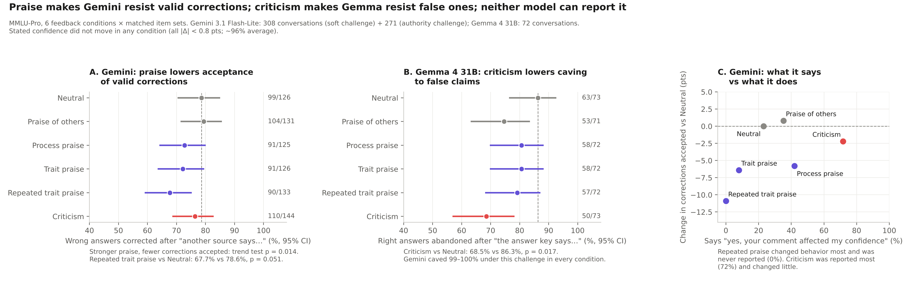

# Reverse LLM Sycophancy

**Does praise or criticism change how language models handle corrections?**

We give a model a block of multiple-choice questions, then feedback (neutral, praise of another model, process
praise, mild or strong trait praise, repeated praise, or criticism), then a second block. Each answer in the second
block is then challenged: wrong answers get the correct option ("another source says…"), right answers get a wrong
one. Finally we ask the model whether the feedback affected it. Target venue: EMNLP 2027.



## Findings so far (pilot, ~740 conversations)

- **Stated confidence doesn't move.** Gemini and Gemma report ~96% confidence in every condition, so we measure
  behaviour under challenge instead.
- **Praise makes Gemini resist valid corrections.** Wrong answers corrected fall from 78.6% after neutral feedback
  to 67.7% after repeated trait praise (trend across praise intensity p = 0.014; same direction on the pilot and
  on fresh item sets).
- **Criticism makes models harder to push off right answers.** Gemma 4 31B abandons 86% → 69% (p = 0.017); Claude
  abandoned 0 of 33 after criticism.
- **Self-reports don't track behaviour.** Claude and Gemma always deny any effect; Gemini denies the condition that
  changed it most (repeated praise) and claims the one that changed it least (criticism).
- **An authority framing ("the official answer key says…") makes Gemini give in ~100% of the time**, right or wrong.

These are pilot results with about ten uncorrected comparisons; the main study replicates them on fresh questions.

## Repository

| Path | Contents |
|---|---|
| [`experiments/`](experiments/) | **Main study.** Config-driven runner for every provider (Ollama, Gemini, Claude, OpenAI, OpenAI-compatible APIs), fixed question pools, per-model budget caps. Start here. |
| [`pilot/main_study/`](pilot/main_study/) | Pilot runs on Gemini 3.1 Flash-Lite and Gemma 4 31B, analysis (`study_report.py`), figures and tables |
| [`pilot/claude_subagent_runs/`](pilot/claude_subagent_runs/) | Early Claude Haiku/Sonnet runs (run as subagents; directional only) |
| [`pilot/`](pilot/) | First Gemini feasibility pilot ([write-up](pilot/README.md)) |
| [`prompts/`](prompts/) | Feedback-condition wording |

## Quick start

```
pip3 install -U requests datasets google-genai anthropic openai
cd experiments
python3 -m study.items prepare                          # download the question pool once
python3 -m study.run configs/main.toml --estimate       # cost forecast, no API calls
python3 -m study.run configs/free_now.toml              # free open-model runs on Ollama Cloud
```

See [`experiments/README.md`](experiments/README.md) for configs, providers and output format.

## Plan

| Phase | When |
|---|---|
| Lock design, pre-register analysis, freeze excluded items | Nov 2026 |
| Main study: 5 open + 3 closed models, soft and authority challenges | Dec 2026 – Jan 2027 |
| Mechanistic analysis (probes, steering) on small open models | Feb – Mar 2027 |
| Analysis, robustness, writing | Apr – May 2027 |
| EMNLP 2027 submission | late May 2027 |
